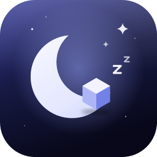
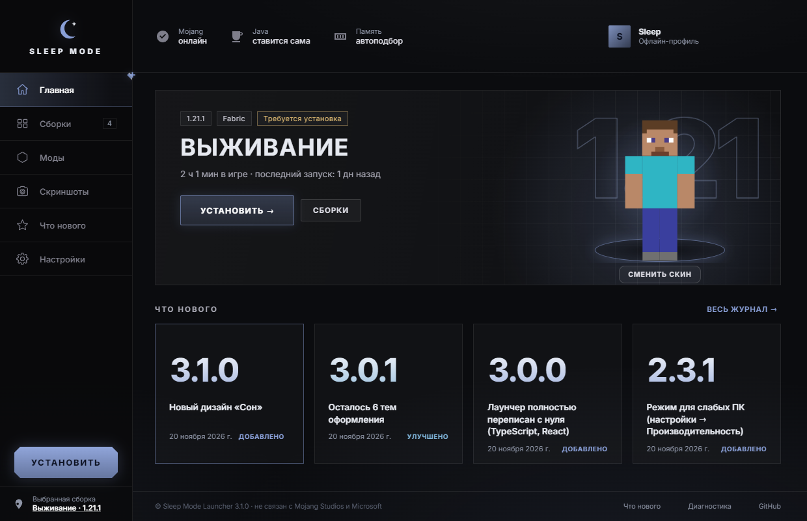
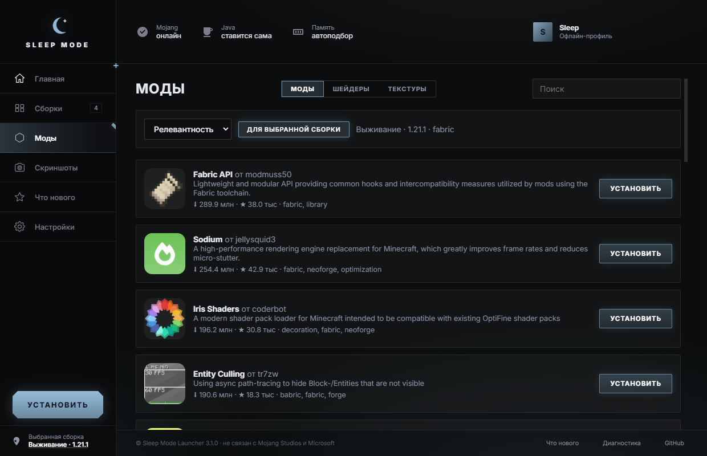
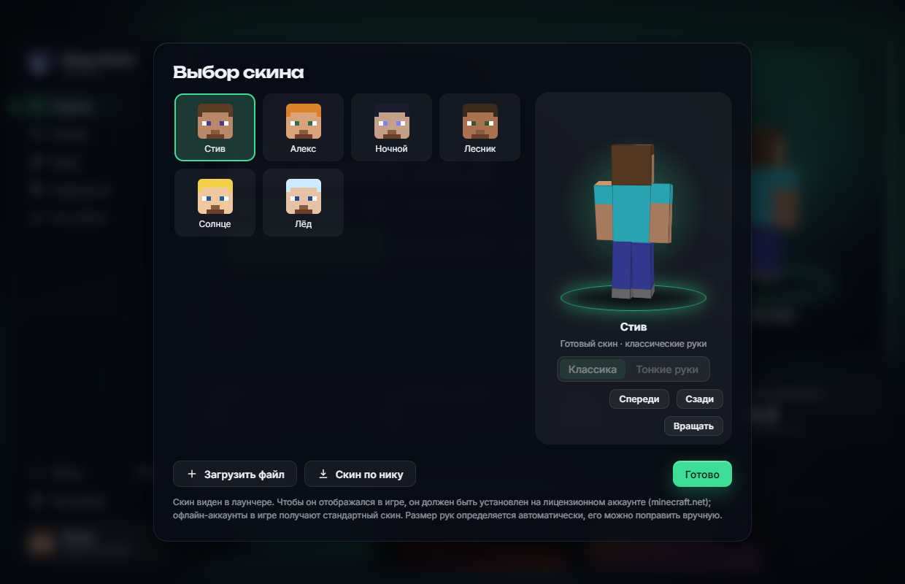

# Sleep Mode Launcher

**Минималистичный лаунчер Minecraft Java Edition**

## Скачать

1. Откройте страницу [**последнего релиза**](https://github.com/theuniqu/sleep-mode-launcher/releases/latest).
2. Скачайте файл `Sleep.Mode.Launcher-Setup-<версия>.exe` из раздела **Assets**.
3. Запустите установщик. Права администратора не нужны, папку установки можно выбрать.

> Windows может показать предупреждение SmartScreen: установщик пока не подписан сертификатом разработчика. Нажмите «Подробнее» → «Выполнить в любом случае».

Дальше лаунчер сам сообщит о новой версии: на главной появится кнопка **«Обновить»**.

## Возможности

| | |
|---|---|
| **Настоящий запуск** | Версии Minecraft из официального манифеста Mojang (релизы, снапшоты, Beta, Alpha), автоматическая загрузка клиента, библиотек и ресурсов, повтор и докачка при обрыве |
| **Java без забот** | Нужная Java (Eclipse Temurin) подбирается по версии игры и ставится сама, с проверкой SHA-256 |
| **Загрузчики** | Fabric, Quilt, Forge, NeoForge; список версий загрузчика зависит от версии Minecraft |
| **Моды, сборки, шейдеры, текстуры** | Каталог Modrinth: поиск, фильтры, автоматические зависимости, обновление модов |
| **Импорт и экспорт сборок** | `.mrpack` (Modrinth) и `.zip` (CurseForge); экспорт сборки для друзей одним файлом |
| **Умные настройки** | Автоподбор памяти и аргументов JVM, профили графики «Слабый ПК / Средний / Максимум» |
| **Миры под защитой** | Автоматические копии миров после игры и восстановление в один клик |
| **Диагностика** | Проверка связи, диска, памяти, Java и целостности файлов; анализ падений игры с подсказками и отключением виновного мода; очистка лишнего |
| **Оформление** | Тёмная и светлая темы, готовые темы-настроения, живые обои, 3D-предпросмотр скина |
| **Лёгкий** | Скрывается в трей на время игры и освобождает память |

  
  

## Вход в аккаунт

- **Офлайн-профиль** по нику работает сразу и подходит для одиночной игры и серверов без проверки лицензии.
- **Microsoft-аккаунт** требует регистрации «приложения лаунчера» в Azure и одобрения Mojang. Пошаговая инструкция и проверка Client ID есть в лаунчере: «Настройки» → «Профили» → «Вход через Microsoft».

## Приватность и безопасность

- Файлы игры, Java и моды скачиваются только с официальных источников Mojang, Eclipse Adoptium и Modrinth, с проверкой контрольных сумм там, где они предоставляются.
- Токены и ключи хранятся в зашифрованном виде (Windows DPAPI).
- Лаунчер не собирает статистику и не отправляет данные о вас никуда, кроме запросов к перечисленным сервисам.
- Установка сборок CurseForge идёт по публичной ссылке сайта CurseForge без API-ключа; проверить хэш таких файлов нельзя.

## Системные требования

Windows 10 или 11 (x64), интернет для первой установки игры. Node.js и среда разработки не нужны.

---

Sleep Mode Launcher не связан с Mojang Studios и Microsoft. Minecraft — торговая марка Mojang Synergies AB.
